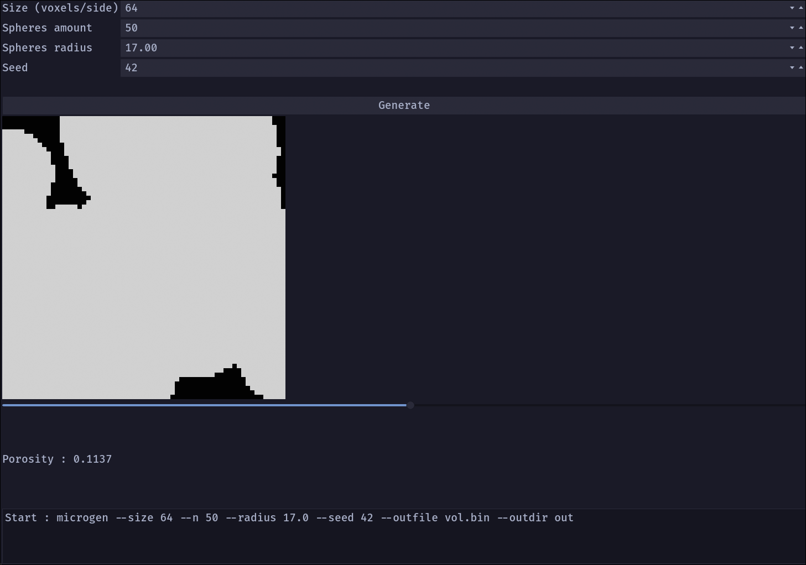

# microgen

A small C++17 tool that generates 3D porous microstructures with a Boolean model, plus a Python GUI to look at them and a script to run parameter sweeps.

I built this in a few days to refresh my knowledge around these technologies: CMake, Google Test, GitLab CI, PySide6, and DAG-based task orchestration. It's a toy version of a real workflow (generate microstructures, compute a property, build a dataset), not a research tool.



## What it does

You give it a cube size, a number of spheres, a radius and a seed. It drops spheres at random positions in the cube and marks every voxel covered by at least one sphere as solid. Overlapping spheres just merge, which is what makes it a Boolean model (union of objects). Then it computes the porosity: the fraction of voxels that stayed empty.

The same seed always gives the same volume, which I rely on for the tests.

## Building

```bash
cmake -S . -B build
cmake --build build
cd build && ctest --output-on-failure
```

You need a C++17 compiler and CMake <3.16> or newer. CLI11, nlohmann/json and GoogleTest are fetched by CMake, so you need network access the first time you configure.

For the GUI:

```bash
python -m venv .venv
source .venv/bin/activate
pip install -r requirements
```

## Running it

```bash
./build/src/microgen --size 64 --n 50 --radius 6 --seed 42 --out out/vol.bin
```

This writes two files:

- `vol.bin`: the raw volume, one byte per voxel (0 empty, 1 solid), indexed as `x + size*(y + size*z)`. In numpy: `np.fromfile(..., dtype=np.uint8).reshape((N, N, N))`, with axes in `(z, y, x)` order.
- `meta.json`: the parameters and the measured porosity. The binary file has no header, so this is how you know its size.

**GUI**: `python gui/app.py` from the project root. Set the parameters, hit the button, and scroll through slices with the slider. It launches `microgen` with `QProcess` so the window doesn't freeze while it runs.

## Things I got wrong along the way

- My first `addSphere` had loop conditions that tested `x` in all three loops, and used `double` loop variables as indices. Wrong voxels, and out-of-bounds writes near the cube edges. Now it uses integer loops over a bounding box, clamped to the volume.
- I set `cmake_minimum_required` to the version installed on my machine, which would have broken the CI image. It's now based on the features the project actually uses.
